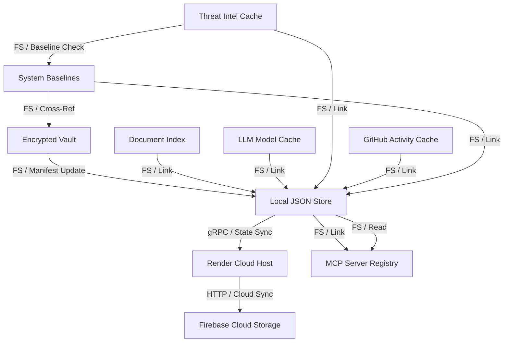
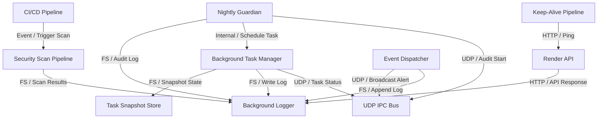
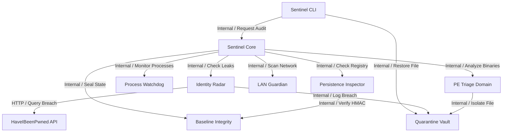
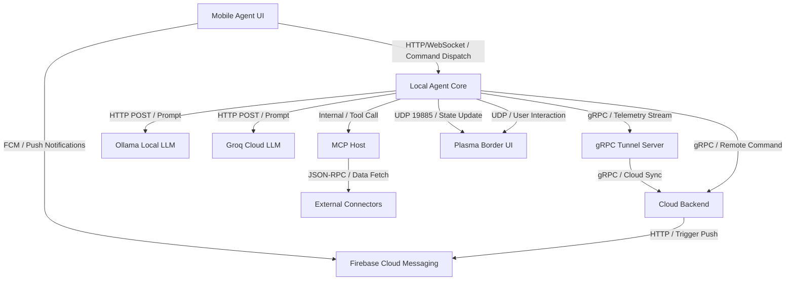
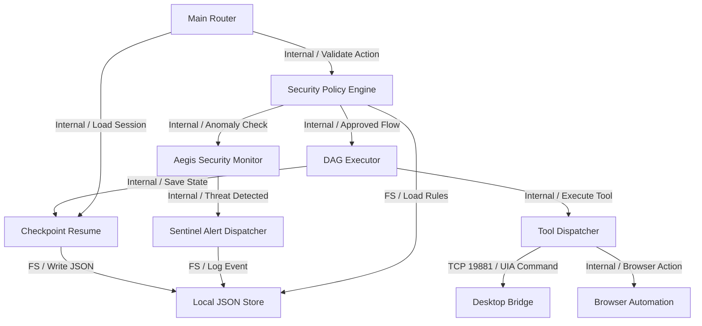
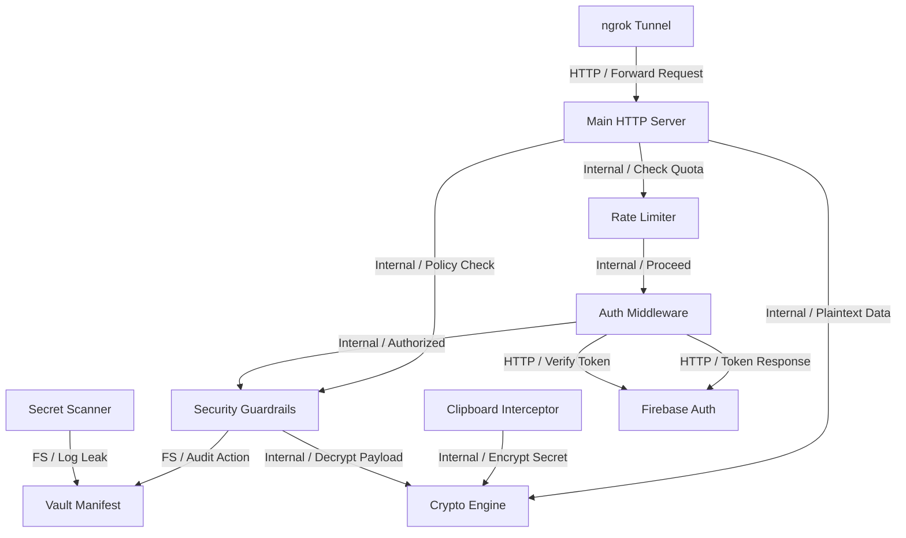

# Contributor Architecture & Onboarding Guide

> Automatically generated by **AI Project Visualizer**.
> Provides an end-to-end architectural mental model, subsystem directory,
> execution workflows, blast radius analysis, and local dev checklist.

---

## 1. Executive System Architecture

- **Analyzed Architecture Categories**: 6
- **Core Architecture Pattern**: Modular Layered Microservices / Monolithic Core
- **Communication Protocols**: HTTP/REST, Internal Service Calls, Persistence Adapters

---

## 2. Subsystem & Component Directory

| Component | Category | Tier | File / Module | Responsibility | Ports / Config |
| :--- | :--- | :--- | :--- | :--- | :--- |
| `Aegis Security Monitor` | Data Flow & Lifecycle | `service` | `local-agent/aegis/aegis_core.py:1` | Anomaly detection using Markov Chains and Z-Scores | `Default` |
| `Sentinel Alert Dispatcher` | Data Flow & Lifecycle | `service` | `local-agent/sentinel/alert_dispatcher.py:1` | Routes security alerts to UDP/HTTP/Logs | `Default` |
| `Auth Middleware` | Security, Auth & Ingress | `middleware` | `main.go:1` | Validates request identity and tokens | `Default` |
| `Baseline Integrity` | Component & Domain Architecture | `domain` | `local-agent/sentinel/baseline_integrity.py:1` | Cryptographic sealing for baseline files | `Default` |
| `Background Logger` | Event Brokers & Async Pipelines | `storage` | `local-agent/bg_logger.go:1` | Dedicated file-based logging for async flows | `Default` |
| `Background Task Manager` | Event Brokers & Async Pipelines | `service` | `local-agent/background_tasks.go:1` | Manages persisted background subprocesses | `Default` |
| `Browser Automation` | Data Flow & Lifecycle | `service` | `local-agent/browser_tools.py:1` | CDP-based browser control with payment guardrails | `Default` |
| `Checkpoint Resume` | Data Flow & Lifecycle | `persistence` | `local-agent/checkpoint_resume.go:1` | Saves and restores conversation state | `Default` |
| `CI/CD Pipeline` | Event Brokers & Async Pipelines | `queue` | `workflows/ci-flutter.yml:1` | Continuous integration for Go/Python/Flutter | `Default` |
| `Clipboard Interceptor` | Security, Auth & Ingress | `middleware` | `local-agent/clipboard_interceptor.go:1` | Redacts secrets from system clipboard | `Default` |
| `Crypto Engine` | Security, Auth & Ingress | `component` | `local-agent/crypto.go:1` | Provides encryption and key derivation | `Default` |
| `DAG Executor` | Data Flow & Lifecycle | `service` | `local-agent/dag_executor.go:1` | Orchestrates multi-agent task graphs | `Default` |
| `Desktop Bridge` | Data Flow & Lifecycle | `service` | `local-agent/desktop_bridge.py:1` | Session-1 daemon for UIA access | `Default` |
| `Document Index` | Persistence & Cloud Infrastructure | `database` | `artifacts/documents/index.json:1` | Index of generated document artifacts | `5432/27017` |
| `Event Dispatcher` | Event Brokers & Async Pipelines | `component` | `local-agent/sentinel/alert_dispatcher.py:1` | Routes events to various sinks | `Default` |
| `Firebase Auth` | Security, Auth & Ingress | `cloud` | `firebase-service-account.json:1` | Cloud-side identity provider | `Default` |
| `Firebase Cloud Messaging` | System Topology (C4) | `cloud` | `app/google-services.json:1` | Push notification and device registration service | `Default` |
| `Firebase Cloud Storage` | Persistence & Cloud Infrastructure | `cloud` | `app/google-services.json:1` | Cloud storage for mobile app assets | `Default` |
| `Mobile Agent UI` | System Topology (C4) | `endpoint` | `mobile-agent/android/app/src/main/kotlin/com/voicecli/voice_cli_temp/MainActivity.kt:1` | Android transparent overlay for voice and agent interaction | `Default` |
| `GitHub Activity Cache` | Persistence & Cloud Infrastructure | `cache` | `local-agent/latest_github_activity.json:1` | Cached issue and activity data from GitHub | `Default` |
| `Groq Cloud LLM` | System Topology (C4) | `cloud` | `connection_data.json:1` | High-speed cloud LLM for complex reasoning | `Default` |
| `gRPC Tunnel Server` | System Topology (C4) | `gateway` | `grpc_server.go:1` | Bidirectional tunnel between cloud backend and desktop agents | `80/443` |
| `HaveIBeenPwned API` | Component & Domain Architecture | `cloud` | `data/hibp_cache.json:1` | External credential leak database | `Default` |
| `Identity Radar` | Component & Domain Architecture | `integration` | `local-agent/sentinel/identity_radar.py:1` | Credential breach check via HIBP API | `Default` |
| `Main Router` | Data Flow & Lifecycle | `gateway` | `main.go:1` | Entry point for all agent requests | `80/443` |
| `Keep-Alive Pipeline` | Event Brokers & Async Pipelines | `queue` | `workflows/keep-alive.yml:1` | Scheduled pings to prevent Render sleep | `Default` |
| `LAN Guardian` | Component & Domain Architecture | `domain` | `local-agent/sentinel/lan_guardian.py:1` | Passive LAN discovery and ARP spoofing detection | `Default` |
| `Local Agent Core` | System Topology (C4) | `service` | `main.go:1` | Primary router and HTTP server managing tool registry and LLM loops | `Default` |
| `Local JSON Store` | Persistence & Cloud Infrastructure | `database` | `local-agent/mcp/config.go:1` | Primary local storage for configuration and state | `5432/27017` |
| `Local JSON Store` | Data Flow & Lifecycle | `database` | `local-agent/mcp/config.go:1` | Filesystem-based persistence for config and state | `5432/27017` |
| `Main HTTP Server` | Security, Auth & Ingress | `endpoint` | `main.go:1` | Handles incoming WebSocket and REST requests | `Default` |
| `External Connectors` | System Topology (C4) | `cloud` | `connectors/catalog.json:1` | Third-party data sources via MCP | `Default` |
| `MCP Host` | System Topology (C4) | `service` | `local-agent/mcp/host.go:1` | Manages lifecycle of external Model Context Protocol servers | `Default` |
| `MCP Server Registry` | Persistence & Cloud Infrastructure | `database` | `local-agent/mcp_servers.json:1` | Configuration for active MCP server processes | `5432/27017` |
| `LLM Model Cache` | Persistence & Cloud Infrastructure | `cache` | `local-agent/ollama_models_cache.json:1` | Cached metadata for available LLM models | `Default` |
| `ngrok Tunnel` | Security, Auth & Ingress | `gateway` | `setup_ngrok.js:1` | Exposes local agent to public internet | `80/443` |
| `Nightly Guardian` | Event Brokers & Async Pipelines | `service` | `local-agent/nightly_guardian.go:1` | Scheduled project audits (Git, cache, deps) | `Default` |
| `Ollama Local LLM` | System Topology (C4) | `cloud` | `scratch/check_model_info.py:1` | Local LLM inference engine for tool calling | `Default` |
| `PE Triage Domain` | Component & Domain Architecture | `domain` | `local-agent/sentinel/pe_triage.py:1` | Static PE header and entropy analysis | `Default` |
| `Persistence Inspector` | Component & Domain Architecture | `domain` | `local-agent/sentinel/persistence_inspector.py:1` | Audits Registry Run keys and Startup folders | `Default` |
| `Plasma Border UI` | System Topology (C4) | `endpoint` | `local-agent/plasma_border.py:1` | Visual AI state overlay on Windows desktop | `Default` |
| `Process Watchdog` | Component & Domain Architecture | `domain` | `local-agent/sentinel/process_watchdog.py:1` | Behavioral telemetry and LOLBin detection | `Default` |
| `Quarantine Vault` | Component & Domain Architecture | `repository` | `local-agent/sentinel/quarantine_vault.py:1` | Encrypted file isolation and manifest management | `Default` |
| `Rate Limiter` | Security, Auth & Ingress | `middleware` | `backend_audit_remediation_test.go:1` | Prevents API abuse and DoS | `Default` |
| `Render API` | Event Brokers & Async Pipelines | `cloud` | `render.yaml:1` | Cloud infrastructure management API | `Default` |
| `Cloud Backend` | System Topology (C4) | `service` | `render.yaml:1` | Central orchestration and state management hosted on Render | `Default` |
| `Render Cloud Host` | Persistence & Cloud Infrastructure | `cloud` | `render.yaml:1` | PaaS hosting for the backend orchestrator | `Default` |
| `Secret Scanner` | Security, Auth & Ingress | `service` | `local-agent/sentinel/secret_scanner.py:1` | Scans local files for leaked API keys | `Default` |
| `Security Guardrails` | Security, Auth & Ingress | `middleware` | `local-agent/SECURITY_GUARDRAILS.md:1` | Implements 'Deny by Default' logic | `Default` |
| `Security Policy Engine` | Data Flow & Lifecycle | `middleware` | `local-agent/security_policy.go:1` | Evaluates actions against security_rules.json | `Default` |
| `Security Scan Pipeline` | Event Brokers & Async Pipelines | `service` | `workflows/ci-security.yml:1` | Async security scanning of codebase | `Default` |
| `Sentinel CLI` | Component & Domain Architecture | `endpoint` | `local-agent/sentinel/sentinel_cli.py:1` | User interface for security audits | `Default` |
| `Sentinel Core` | Component & Domain Architecture | `service` | `local-agent/sentinel/sentinel_core.py:1` | Aggregates telemetry for host posture score | `Default` |
| `System Baselines` | Persistence & Cloud Infrastructure | `database` | `local-agent/sentinel/data/persistence_baseline.json:1` | Signed snapshots of system startup state | `5432/27017` |
| `Task Snapshot Store` | Event Brokers & Async Pipelines | `database` | `local-agent/background_tasks_test.go:1` | Persistence for background task state | `5432/27017` |
| `Threat Intel Cache` | Persistence & Cloud Infrastructure | `cache` | `local-agent/aegis/data/aegis_markov.json:1` | Markov chain and Z-score statistical data | `Default` |
| `Tool Dispatcher` | Data Flow & Lifecycle | `component` | `local-agent/mcp_wiring.go:1` | Maps LLM tool calls to actual function implementations | `Default` |
| `UDP IPC Bus` | Event Brokers & Async Pipelines | `queue` | `local-agent/plasma_border.py:1` | Low-latency event bus for UI updates | `Default` |
| `Vault Manifest` | Security, Auth & Ingress | `database` | `local-agent/sentinel/vault/vault_manifest.json:1` | Audit manifest for quarantined files | `5432/27017` |
| `Encrypted Vault` | Persistence & Cloud Infrastructure | `storage` | `local-agent/sentinel/quarantine_vault.py:1` | Secure storage for quarantined binaries | `Default` |

---

## 3. Architecture Fragility & Single Points of Failure (SPOF)

Components with high inbound callers pose high blast radius upon interface changes.

| Critical Component | Inbound Callers | Outbound Dependencies | Fragility Risk | Blast Profile |
| :--- | :--- | :--- | :--- | :--- |
| `Local JSON Store` | 6 callers | 3 dependencies | **HIGH RISK (CRITICAL INFRASTRUCTURE)** | High fan-in junction |
| `Background Logger` | 5 callers | 0 dependencies | **HIGH RISK (CRITICAL INFRASTRUCTURE)** | High fan-in junction |
| `Quarantine Vault` | 3 callers | 0 dependencies | **MEDIUM RISK** | High fan-in junction |
| `Local JSON Store` | 3 callers | 0 dependencies | **MEDIUM RISK** | High fan-in junction |
| `UDP IPC Bus` | 3 callers | 0 dependencies | **MEDIUM RISK** | High fan-in junction |
| `Crypto Engine` | 3 callers | 0 dependencies | **MEDIUM RISK** | High fan-in junction |
| `Cloud Backend` | 2 callers | 1 dependencies | **MEDIUM RISK** | High fan-in junction |
| `Vault Manifest` | 2 callers | 0 dependencies | **MEDIUM RISK** | High fan-in junction |
| `Plasma Border UI` | 2 callers | 0 dependencies | **MEDIUM RISK** | High fan-in junction |
| `MCP Server Registry` | 2 callers | 0 dependencies | **MEDIUM RISK** | High fan-in junction |
| `Firebase Cloud Messaging` | 2 callers | 0 dependencies | **MEDIUM RISK** | High fan-in junction |
| `Security Guardrails` | 2 callers | 2 dependencies | **MEDIUM RISK** | High fan-in junction |
| `Firebase Auth` | 2 callers | 0 dependencies | **MEDIUM RISK** | High fan-in junction |
| `Baseline Integrity` | 2 callers | 0 dependencies | **MEDIUM RISK** | High fan-in junction |
| `Checkpoint Resume` | 2 callers | 1 dependencies | **MEDIUM RISK** | High fan-in junction |
| `Sentinel Core` | 1 callers | 6 dependencies | LOW RISK | High fan-in junction |
| `Security Policy Engine` | 1 callers | 3 dependencies | LOW RISK | High fan-in junction |
| `Main HTTP Server` | 1 callers | 3 dependencies | LOW RISK | High fan-in junction |
| `Local Agent Core` | 1 callers | 7 dependencies | LOW RISK | High fan-in junction |
| `Auth Middleware` | 1 callers | 3 dependencies | LOW RISK | High fan-in junction |
| `Background Task Manager` | 1 callers | 3 dependencies | LOW RISK | High fan-in junction |
| `Nightly Guardian` | 0 callers | 3 dependencies | LOW RISK | High fan-in junction |

---

## 4. Local Development & Setup Checklist

- [ ] **Runtime**: Ensure Node.js / Python / Docker runtimes matching requirements are installed.
- [ ] **Environment Configuration**: Configure necessary ports and environment variables.
- [ ] **Databases & Caches**: Ensure local containers or connection strings for detected storage nodes are configured.

---

## 5. Architectural Topology Diagrams (Mermaid)

### Persistence & Cloud Infrastructure

### Event Brokers & Async Pipelines

### Component & Domain Architecture

### System Topology (C4)

### Data Flow & Lifecycle

### Security, Auth & Ingress

